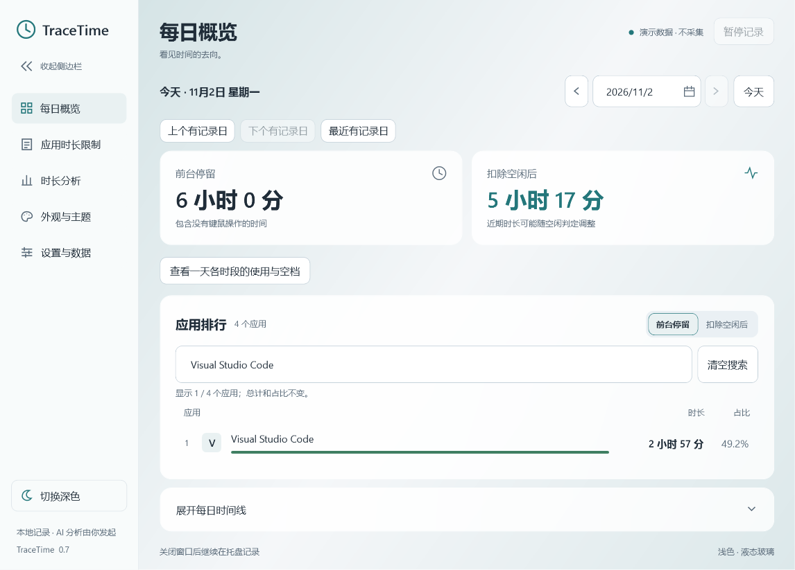
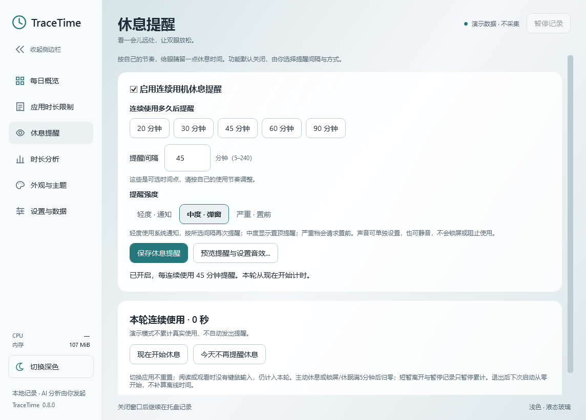
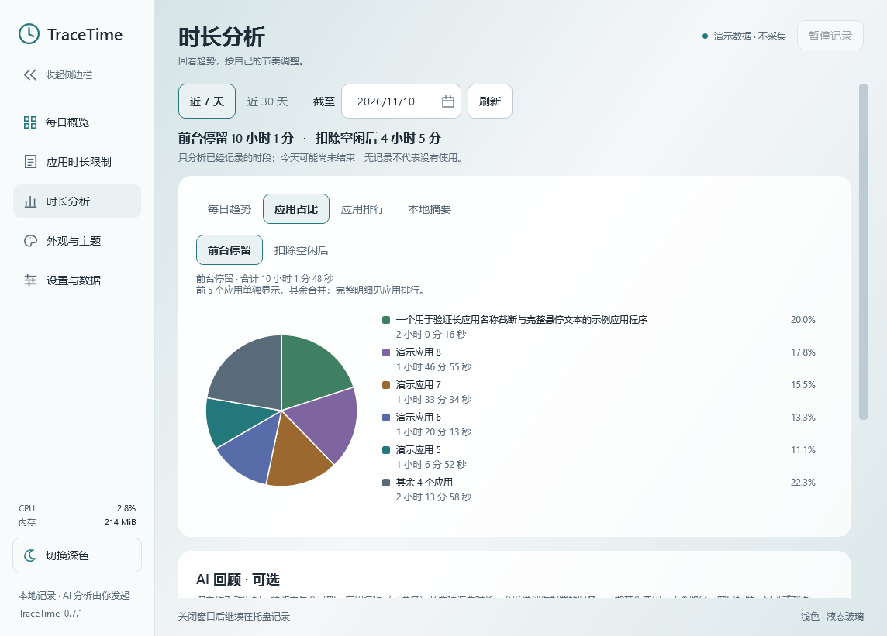
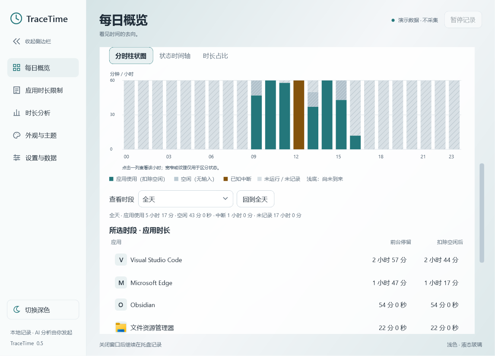
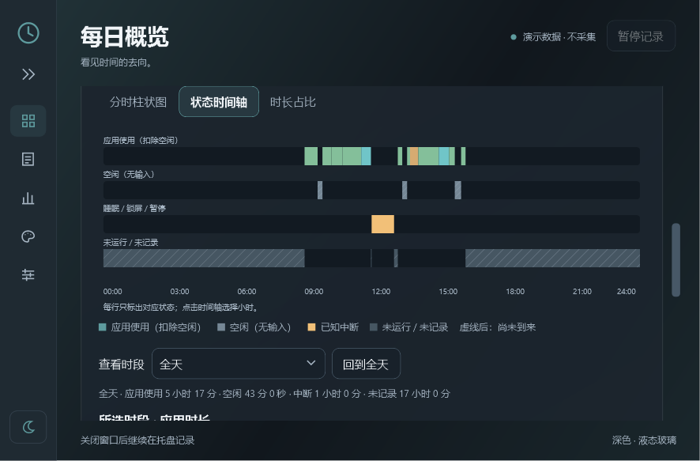
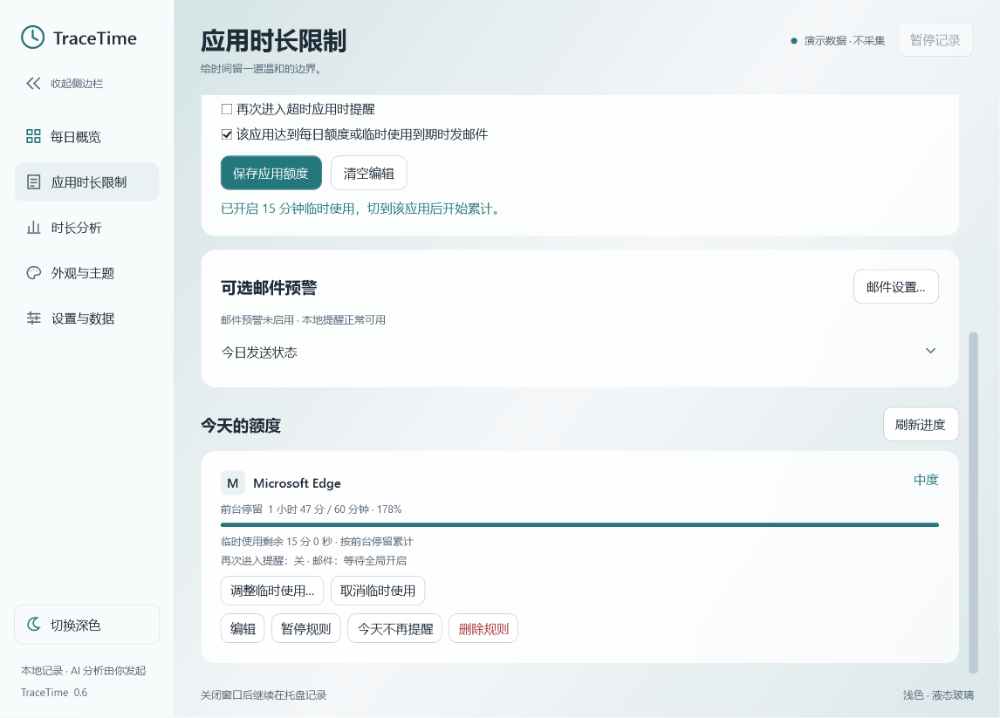
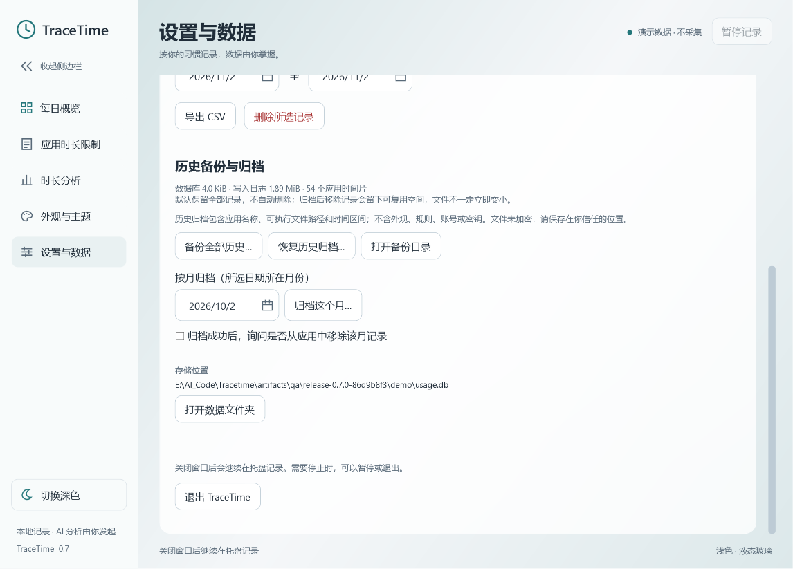
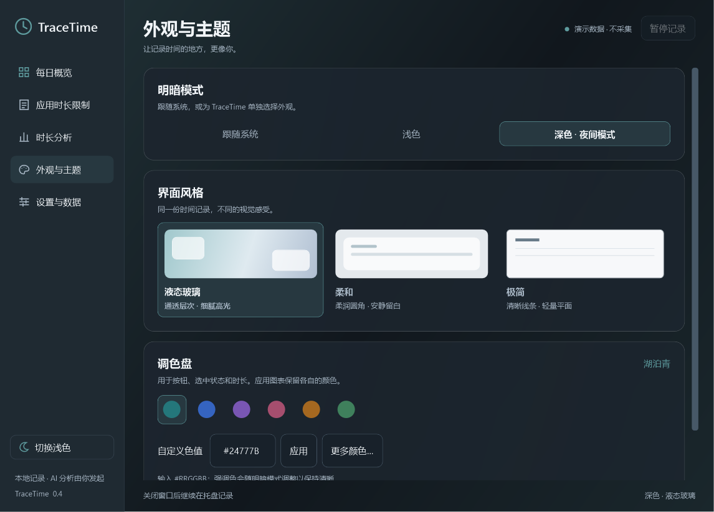

<h1 align="center">TraceTime</h1>

<p align="center"><strong>看见时间的去向。</strong><br>以轻量常驻为目标的 Windows 本地应用时间记录工具。</p>

<p align="center">
  <a href="https://github.com/xuanyuanyuzhen/Tracetime/releases"></a>
  
  
  
</p>

<p align="center">
  <a href="https://github.com/xuanyuanyuzhen/Tracetime/releases/latest">下载最新版</a> ·
  <a href="#快速开始">快速开始</a> ·
  <a href="#界面预览">界面预览</a> ·
  <a href="#文档与反馈">使用文档</a> ·
  <a href="https://github.com/xuanyuanyuzhen/Tracetime/issues">反馈问题</a>
</p>



TraceTime 常驻系统托盘，自动记录当前前台应用。你可以回看一天的时间分布、比较近 7 / 30 日趋势，为应用设置使用提醒，也可以将历史记录导出、备份和归档。本地记录和统计无需账号、网络或 AI 服务。

**同时保留「前台停留」与「扣除空闲后」两种时长。没有键鼠输入，也可能是在阅读、思考或看视频；空闲不等于没有工作。**

## 功能一览

| 功能 | 可以做什么 |
| --- | --- |
| 自动记录 | 按前台应用累计时长，同一应用的多个窗口合并；支持托盘常驻、暂停 / 恢复和单实例运行 |
| 每日回顾 | 查看双时长排行、完整时间片、分时柱状图、状态时间轴和时长占比环图；按小时查看各应用使用情况 |
| 搜索与日期导航 | 按名称搜索应用与额度规则；通过记录日历、上 / 下个有记录日和最近有记录日快速跳转 |
| 应用使用提醒 | 每日额度可选两种统计口径；轻度 / 中度 / 严重三档提醒、超时后再次进入提醒、临时使用和今日全部静默 |
| 休息提醒 | 默认关闭，按连续用机时长提示休息；多个时间预设、自定义间隔、三档强度与独立音效 |
| 趋势与分析 | 本地近 7 / 30 日趋势、应用占比饼图、排行与摘要；图表悬停显示时长到秒，可选手动发送汇总给 AI 分析 |
| 自身资源占用 | 侧栏显示TraceTime的CPU与内存，每2秒更新；隐藏/最小化时暂停资源采样 |
| 数据管理 | 导出双时长 CSV、按日期删除、完整历史备份、按月归档与恢复；归档默认保留原记录 |
| 外观与音效 | 跟随系统 / 浅色 / 深色，液态玻璃 / 柔和 / 极简，预设与自定义强调色、可收起侧栏，以及提醒音效预览 |
| 可选邮件提醒 | 使用自己的 SMTP STARTTLS 服务发送额度或临时使用到期提醒；全局与每条规则均默认关闭 |

## 轻量化优先

0.8.1将托盘概览和时间线改为按需计算，隐藏或最小化时暂停界面刷新，复用排行控件、统计结果和前台识别缓冲区。计时采样与提醒继续运行，功能默认值保持不变。Windows x64运行包也只保留需要的原生依赖。

占用随历史数据、界面状态与系统环境变化。具体对照数据、复测脚本和长期测量边界见[轻量化与资源测量](docs/PERFORMANCE.md)；侧栏瞬时数字不作为固定内存承诺。

本次同机合成数据短测中，托盘平均工作集约 **121 → 94 MiB**；框架依赖ZIP约 **19.88 → 4.41 MiB**。这两项分别衡量运行内存与下载体积，测试条件见上方说明。

## 快速开始

### 下载与运行

**0.8.1** 提供 Windows x64 ZIP 包，在0.8.0的休息提醒、图表和资源占用显示基础上进一步降低常驻开销与下载体积。已验证平台为 Windows 11 x64，见[发布说明](docs/releases/v0.8.1.md)。

1. 安装 [Microsoft .NET 10 Desktop Runtime](https://dotnet.microsoft.com/en-us/download/dotnet/10.0)，在 **.NET Desktop Runtime** 下选择 **Windows x64**。运行应用无需安装 SDK。
2. 打开 [最新 Release](https://github.com/xuanyuanyuzhen/Tracetime/releases/latest)，在 **Assets** 下载 `TraceTime-0.8.1-win-x64.zip`。GitHub 自动生成的 `Source code` 是源码包。
3. 将 ZIP 完整解压到固定文件夹，运行其中的 `TraceTime.exe`。请保留全部文件，不要只复制 EXE。
4. 正常启动后即开始记录。在「每日概览」查看使用情况，在「设置与数据」调整空闲阈值、导出或备份历史。

关闭主窗口后，程序仍在系统托盘记录。点击托盘图标重新打开，右键菜单可暂停、恢复或退出。开机启动默认关闭，需要时在设置中主动开启。

<details>
<summary>校验下载文件</summary>

Release 同时提供 `TraceTime-0.8.1-win-x64.zip.sha256`。在下载目录运行：

```powershell
Get-FileHash .\TraceTime-0.8.1-win-x64.zip -Algorithm SHA256
Get-Content .\TraceTime-0.8.1-win-x64.zip.sha256
```

两处 SHA-256 应一致，字母大小写不影响比较。

</details>

### 从旧版升级

升级前先备份数据：旧版支持历史备份时，可通过「设置与数据 → 历史备份与归档」操作；更早版本请先退出，再复制整个 `%LOCALAPPDATA%\TraceTime` 目录。随后从旧版托盘菜单选择「退出」（如仍在运行），解压并启动新版本。程序文件与用户数据分开保存，同一 Windows 用户启动新版时会继续使用原有数据目录。

如果启用了开机启动并更换了程序位置，请在新版设置中重新勾选并保存启动选项。当前没有安装器、自动更新或代码签名。版本变化见 [0.8.1 发布说明](docs/releases/v0.8.1.md)。

## 界面预览

下列图片均来自隔离演示数据，不包含个人使用记录。

### 可选的连续用机休息提醒



### 应用占比与自身资源占用



### 一天的使用与空档



<details>
<summary>查看更多：深色时间轴、应用提醒、历史备份与外观</summary>

**深色模式与图标侧栏**



**应用额度与临时使用**



**历史备份与按月归档**



**材质、主题与调色盘**



</details>

## 时长是怎样计算的

| 口径 | 含义 |
| --- | --- |
| 前台停留 | 记录开启且会话可用时，应用处于前台的累计时间，包含没有键鼠输入的时间 |
| 扣除空闲后 | 从前台停留中减去已判定为空闲的交集；不作为工作时长或专注程度评分 |

默认连续 **5 分钟**没有键鼠输入时判为空闲，并从最后一次输入时刻回扣。例如 10:00 最后输入、10:12 恢复输入，这 12 分钟保留在前台停留中，从另一口径中扣除。因此，最近几分钟的「扣除空闲后」数值可能调整。

- 同一时刻只归属一个前台应用，后台音乐、下载或渲染不会继续累计前台时长。
- 锁屏、休眠、会话断开和手动暂停期间不计入应用时长；未运行期间的空档不会补算。
- 跨午夜按本地日期拆分；修改空闲阈值只影响之后的记录。
- 浏览器按 Chrome、Edge 等应用统计，不细分网页。没有证据的空档显示为未记录，不推断关机原因。
- 搜索只筛选应用列表，不改变当天总计、占比分母或图表汇总范围。

## 数据与隐私

默认数据目录为：

```text
%LOCALAPPDATA%\TraceTime\
```

`usage.db` 保存应用身份、显示名称、可执行文件路径，以及前台、空闲和中断区间。外观、视图偏好和可选服务配置保存在同目录。**不记录窗口标题、网页地址、文档名、键盘输入内容或屏幕截图。** 液态玻璃样式由 WPF 内部绘制，不抓取桌面图像。

本地数据库和 `.ttarchive` 历史归档未加密。归档仅包含历史记录，不包含额度规则、外观偏好或服务凭据。请通过应用内「备份全部历史」获取运行中数据库的一致性快照；如果需要完整迁移数据与配置，先退出程序，再复制整个数据目录。不要仅复制正在使用的 `usage.db`，其最新记录可能仍在 WAL 日志中。

外部服务均为可选功能：

| 功能 | 何时联网、发送什么 |
| --- | --- |
| AI 分析 | 用户预览汇总并手动确认后才发送，默认匿名应用名称；仅含日期及应用汇总时长，不发路径或原始时间片。手动获取模型列表会向所配置服务发送鉴权信息 |
| 邮件提醒 | 用户配置 SMTP 且同时开启全局与规则邮件开关后，在达到额度或临时使用到期时发送日期、应用名称、时长及提醒类型等摘要 |

AI 密钥和 SMTP 凭据使用当前 Windows 用户的 DPAPI 保护。邮件支持 STARTTLS（常用端口 587），暂不支持 465 隐式 TLS；失败后由用户手动重试。具体范围见 [应用额度与分析](docs/LIMITS-AND-ANALYSIS.md) 和 [提醒与邮件说明](docs/REMINDERS-AND-ROADMAP.md)。

## 常见问题

**为什么刚启动没有历史？** 记录从程序启动时开始，不能还原此前或退出期间的使用情况。需要日常持续记录时，可主动启用开机启动。

**为什么应用没有出现在额度列表中？** 列表来自已有使用记录。先打开目标应用并在前台使用几秒，再刷新列表。

**到达额度后会强制关闭应用吗？** 不会。三档提醒改变通知方式与确认强度，不关闭或封锁目标应用。严重提醒会请求唤起 TraceTime，但 Windows 可能限制前台焦点。

**临时使用的分钟数如何扣减？** 按目标应用的前台停留累计，含空闲；后台、暂停和锁屏不消耗。可设 1–120 分钟、保存常用时长，到次日结束。

**休息提醒怎样计时？** 按本轮连续使用电脑累计，切换应用和键鼠空闲不重置；主动休息或锁屏/休眠满5分钟后归零。暂停记录只暂停累计，重启从零开始。休息提醒默认关闭，音效独立，详见 [使用说明](docs/BREAK-REMINDERS.md)。

**归档会删掉记录吗？** 默认仅复制。移除已结束月份须另行确认；恢复前自动备份，再替换归档覆盖范围，重复恢复不会叠加时长。操作细节见 [历史管理说明](docs/HISTORY-AND-QUICK-ACTIONS.md)。

## 从源码构建

使用 Windows x64 和 **.NET 10 SDK**。`global.json` 声明 SDK 10.0.402，依赖由项目文件和 `packages.lock.json` 记录。构建脚本优先使用项目内 `.tools\dotnet`，否则使用系统 `dotnet`。

```powershell
git clone https://github.com/xuanyuanyuzhen/Tracetime.git
cd Tracetime

# 可选：下载项目声明的 SDK 到 .tools，不修改系统 PATH
.\scripts\setup-dotnet.ps1

# 恢复依赖、Release 构建并运行确定性场景验证
.\scripts\build.ps1 -Test

# 生成发布目录、ZIP 和 SHA-256（需要桌面运行时）
.\scripts\build.ps1 -Test -Publish

# 验证实际发布包，所有写入均使用独立测试数据目录
.\scripts\verify-release.ps1
```

当前源码产物位于 `artifacts\release\TraceTime-0.8.1-win-x64`。依赖已恢复时可使用 `-Offline`；需要自行生成包含运行时的包时可使用 `-SelfContained`（需要下载对应运行时依赖，当前 Release 附件为框架依赖包）。0.8.1按win-x64解析原生依赖，避免混入其他平台的SQLite库。

若默认发布目录中的程序正在运行，可给构建和验证脚本都传入 `-ReleaseRoot artifacts\release\fresh`，在独立目录生成并验证包，避免覆盖运行中的文件。

### 项目结构

```text
src/
  TraceTime.Core/       # 计时状态机、双口径汇总、提醒与分析
  TraceTime.Storage/    # SQLite、CSV、历史备份 / 归档 / 恢复
  TraceTime.App/        # WPF 界面、Windows 采集、托盘与设置
tests/TraceTime.Tests/  # 确定性场景验证，失败返回非零退出码
scripts/               # SDK 准备、构建打包与发布验证
docs/                  # 使用指南、发布说明、演示截图与验证记录
PLAN.md                # 产品范围与计时规则
WORKLOG.md             # 当前进度、验证结果与接手入口
```

核心计时逻辑可脱离 Windows 界面，通过模拟时钟和状态事件验证。预览界面可在发布目录运行 `TraceTime.exe --demo`：使用临时演示数据，不采集实际使用记录。

### 验证状态

当前源码累计 **98 项场景**通过；0.8.1正式包验证了托盘延迟加载、最小化停止界面刷新、恢复窗口、排行行复用及时间线完整恢复，并保留计时、提醒与双口径回归。具体证据见[验证记录](docs/VALIDATION.md)，短时资源对照见[性能说明](docs/PERFORMANCE.md)。AI与邮件使用模拟服务验证。

实际锁屏 / 休眠、多显示器、长期资源占用、真实 AI / SMTP 服务和大型历史归档仍需进一步实测。项目目前提供 Windows 桌面端；手机端与多设备同步尚未实现。

## 文档与反馈

| 文档 | 内容 |
| --- | --- |
| [0.8.1 发布说明](docs/releases/v0.8.1.md) | 视图按需计算、分配减少、Windows x64包精简 |
| [0.8.0 发布说明](docs/releases/v0.8.0.md) | 新休息提醒、合并0.7.1改进与升级须知 |
| [轻量化与资源测量](docs/PERFORMANCE.md) | 优化措施、对照数据、复测方法与适用边界 |
| [连续用机休息提醒](docs/BREAK-REMINDERS.md) | 开关、间隔、强度、音效、休息/稍后与计时规则 |
| [搜索、快捷操作与历史管理](docs/HISTORY-AND-QUICK-ACTIONS.md) | 日期跳转、今日静默、常用分钟、备份和恢复 |
| [全天分布与提醒音效](docs/DAY-AND-REMINDERS.md) | 图表操作、时段明细、提醒预览和自定义 WAV |
| [应用额度与分析](docs/LIMITS-AND-ANALYSIS.md) | 额度规则、本地趋势与可选 AI 分析 |
| [提醒与后续优化](docs/REMINDERS-AND-ROADMAP.md) | 再次进入提醒、临时使用、SMTP 及后续评估 |
| [验证记录](docs/VALIDATION.md) | 已验证场景、证据与当前限制 |

欢迎通过 [GitHub Issues](https://github.com/xuanyuanyuzhen/Tracetime/issues) 提交问题或建议。反馈时请附版本、Windows 版本、复现步骤、预期结果与实际结果；请勿公开个人数据库、归档或服务密钥。
