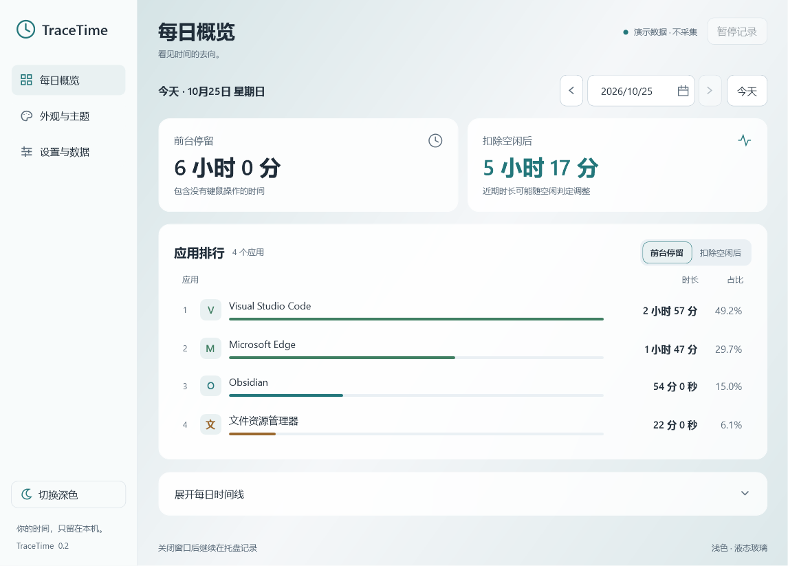
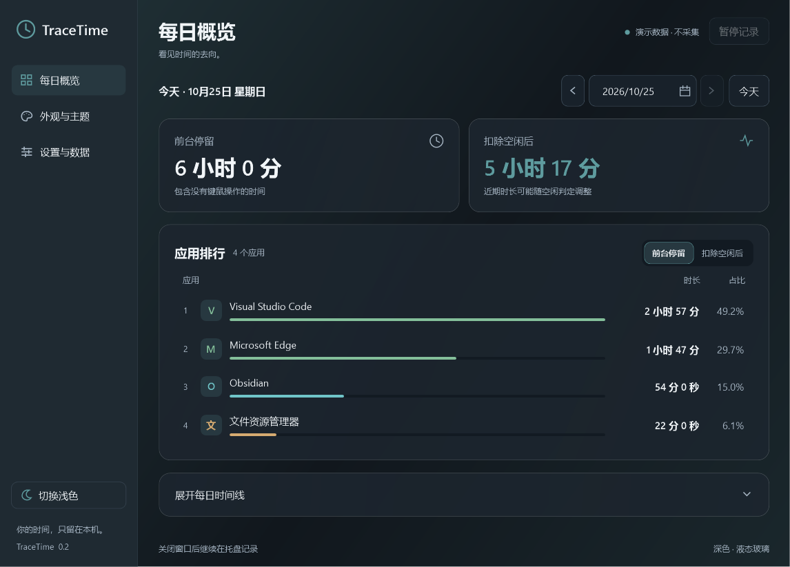
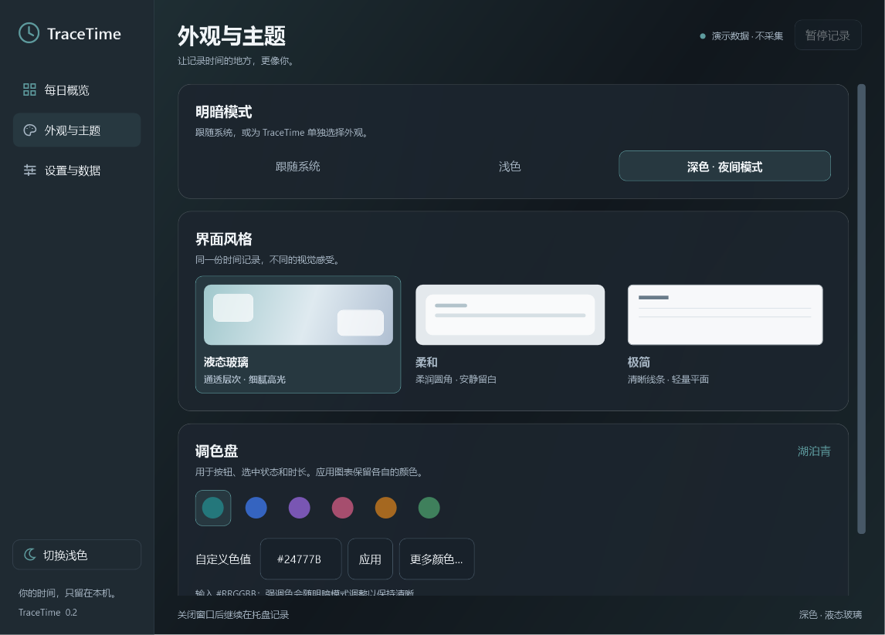

# TraceTime

Windows 本地前台应用时间记录工具。自动记录每日应用排行与时间线，同时保留「前台停留」和「扣除空闲后」两种口径。







## 直接运行

解压 `TraceTime-0.2.0-win-x64.zip`，打开整个 `TraceTime-0.2.0-win-x64` 文件夹中的 `TraceTime.exe`。

升级时先从旧版托盘菜单选择「退出」，再启动新版本。用户数据目录相同，历史记录保留。

- 当前发布包需要 .NET 10 Desktop Runtime x64（这台电脑已安装），无需安装 SDK。请保留整个文件夹，不要只复制 EXE。
- 从启动开始记录，无法补回安装前或未运行期间的使用记录。
- 关闭主窗口后继续在系统托盘记录；点托盘图标重新打开，右键菜单可暂停或退出。
- 在「设置与数据」中调整空闲阈值、导出 CSV、删除日期范围或主动启用登录后启动。
- 在「外观与主题」中选择跟随系统、浅色或深色（夜间模式），以及液态玻璃、柔和或极简风格。
- 首次启动默认跟随系统 + 液态玻璃；之后立即保存选择，重启恢复明暗模式、风格和强调色。调色盘提供六个预设、十六进制色值及系统颜色选择器。
- 开机启动默认关闭。需要开启时，先把整个程序文件夹放到固定位置，再勾选并保存。

数据默认位于 `%LOCALAPPDATA%\TraceTime\usage.db`。SQLite 使用 WAL，运行中不要单独复制数据库文件作备份；先通过托盘退出，再复制整个数据目录。程序文件和用户数据分离，替换程序文件不会主动清空历史。

外观偏好保存在同目录的 `appearance.json`，独立于使用记录。玻璃风格使用 WPF 内部半透明层叠和高光，不读取桌面图像；Windows 高对比度开启时使用系统颜色和不透明表面。系统对话框保留原生外观。

## 统计口径

- 前台停留：一个时刻仅归属当前前台应用；同应用多个窗口合并。
- 扣除空闲后：默认连续 5 分钟没有键鼠输入，回扣从最后一次输入开始的区间。阅读或观影也可能被判定为空闲，因此该指标不等于工作或专注时间。
- 调整空闲阈值只影响之后的记录。最近几分钟的数值可能随空闲判定回调。
- 锁屏、休眠、会话断开和暂停期间不计入应用时长。程序中断后不补算空档。
- 浏览器仅按应用统计，后台音乐与下载不计入前台时长。
- 不记录窗口标题、文档名、网址、按键内容或截图。

## 开发

要求 Windows x64、.NET 10 SDK。项目使用 `global.json` 固定 SDK，依赖版本写入各项目和 `packages.lock.json`。

```powershell
# 可选：在项目内准备 SDK，不修改系统 PATH
.\scripts\setup-dotnet.ps1

# 构建与场景验证
.\scripts\build.ps1 -Test

# 创建使用现有桌面运行时的发布目录和 ZIP
.\scripts\build.ps1 -Test -Publish

# 无需联网，使用已有依赖构建并打包
.\scripts\build.ps1 -Test -Publish -Offline

# 使用独立数据目录验证实际运行包（暂停、托盘、单实例、外观与重启）
.\scripts\verify-release.ps1

# 在网络可用时，另外生成自包含包（包括运行时）
.\scripts\build.ps1 -Test -Publish -SelfContained
```

目录说明：

- `src/TraceTime.Core`：纯计时状态机、日期汇总、空闲交集。
- `src/TraceTime.Storage`：SQLite、设置、CSV 和日期删除裁剪。
- `src/TraceTime.App`：WPF 界面、Windows 事件和托盘。
- `tests/TraceTime.Tests`：无需额外测试框架的确定性场景，失败时退出码非零。
- `PLAN.md`：产品范围；`WORKLOG.md`：当前进展、验证与交接事项。

## 隔离验证

```powershell
# 演示界面：使用临时目录、显示演示标记，不采集使用记录
TraceTime.exe --demo

# 显式指定独立测试目录，15 秒后自动退出并写入 smoke-result.txt
TraceTime.exe --data-dir C:\Temp\TraceTimeSmoke --smoke-seconds 15
```

正式记录请正常启动，不带 `--demo`。沙箱或非交互桌面可能无法识别真实前台窗口，真实采集应在当前用户的正常 Windows 会话中运行。

## 当前验证范围

核心与 SQLite 场景已覆盖空闲回扣、应用切换、跨日、夏令时、阈值修改、暂停恢复、长观测空档、持久化恢复及导出/删除。实机短时采集和暂停已经验证。

应用内隔离流程检查覆盖暂停恢复、设置保存、关闭到托盘后继续记录、重新显示、日期和口径切换。界面完整时间片列表不截断，支持键盘滚动。桌面自动点击工具发生几何信息错误，尚未完整完成逐项人工交互验收。

0.2 验证还包括主题控制、54 组配色的基础表面与实际选中状态对比度、日历月份/年份切换、首次默认外观及新进程恢复选择。详情及未验证范围见 `docs/VALIDATION.md`。

真实锁屏/休眠、多显示器、长时间运行和开机启动仍需正常使用中的进一步验证；没有为了测试改变电脑的锁屏、电源或启动设置。第一版尚未做安装器、自动更新或代码签名。
