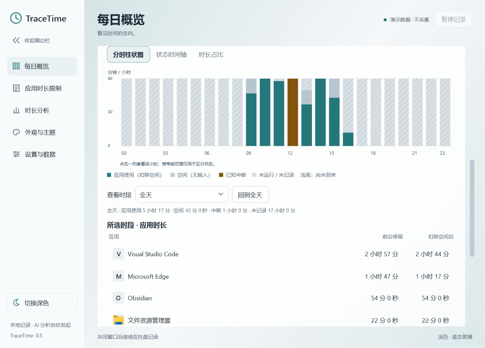
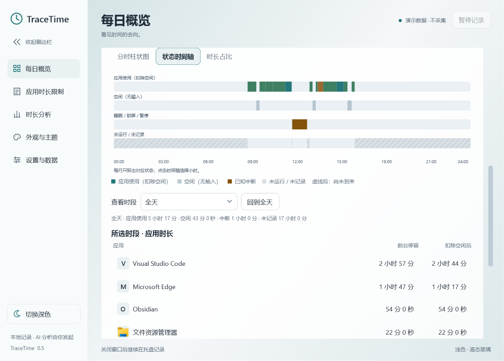
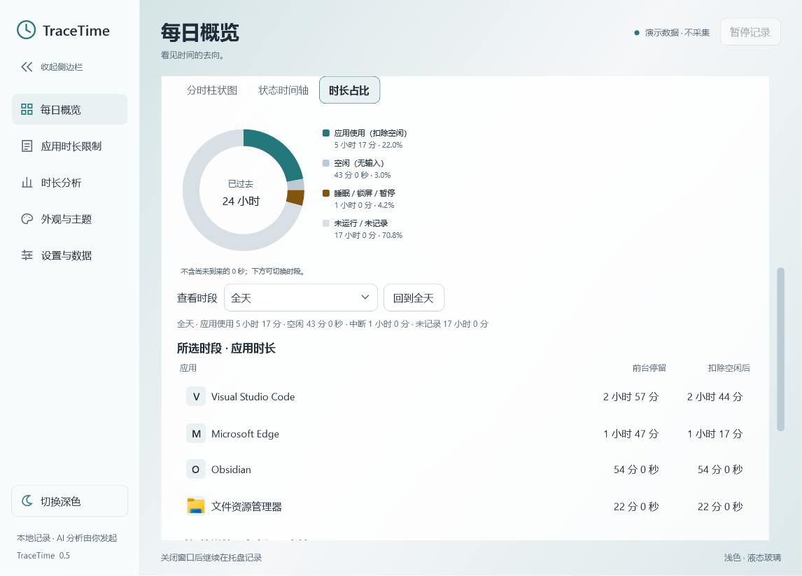
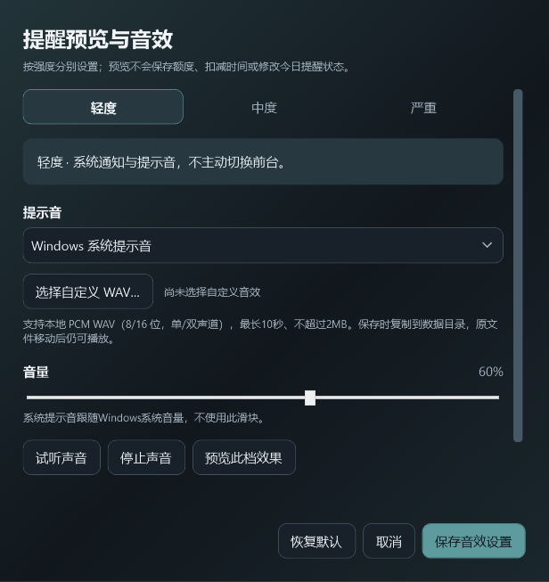
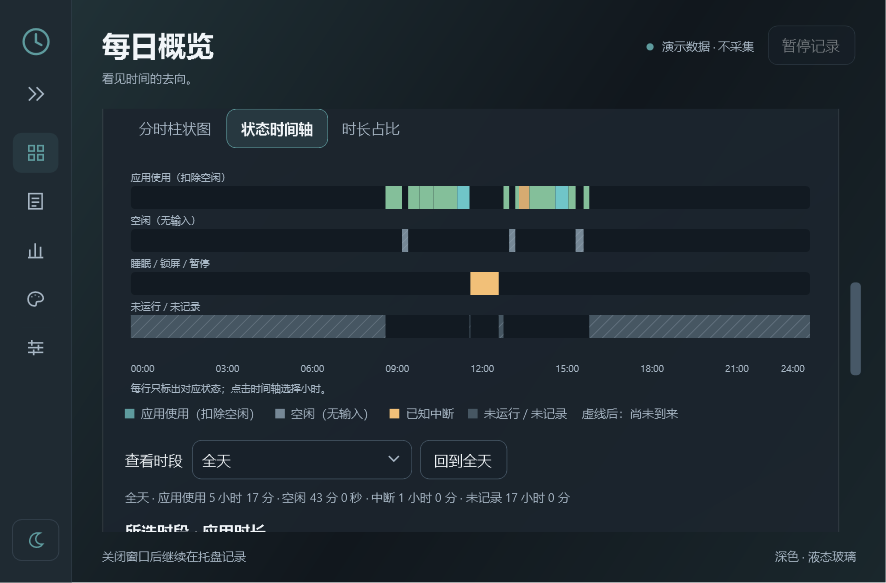

# 全天分布与提醒音效（0.5）

## 查看一天中的各个时段

在「每日概览」选择日期，点击双时长面板下方的「查看一天各时段的使用与空档」。

| 图表 | 适合查看 |
| --- | --- |
| 分时柱状图 | 每小时有多少应用使用、空闲和空档；悬停显示准确时长 |
| 状态时间轴 | 各状态实际发生的时间；使用区间按软件着色 |
| 时长占比 | 全天或所选小时已经过去的时间中，各状态的比例 |

点击柱条或时间轴可选小时，也可通过下拉框选择。柱图/时间轴获得键盘焦点后，左右键选择小时，Escape 回到全天。环图通过下拉框切时段，方向键查看各项数值、Escape关闭提示。图表类型会自动保存。

0.7.1起，柱条、时间轴区间、环图扇区和图例支持精确到秒的悬停详情；环图中心不触发提示，分母不含尚未到来的时间。鼠标移开、页面滚动或切换时提示收起。

所选时段的应用表同时列出「前台停留」与「扣除空闲后」。前台停留包含空闲；下方完整时间片还包含未记录空档。点选每日排行软件后，仅筛选时间片并在状态时间轴中突出该软件，图表与时段应用表仍显示全部软件，筛选说明位于时间片标题下。

## 空闲、睡眠与关机怎么显示

| 状态 | 含义与统计 |
| --- | --- |
| 应用使用（扣除空闲） | 前台记录中未被判为空闲的部分 |
| 空闲（无输入） | 达到空闲阈值后的无输入区间，仍保留在对应软件的前台停留中；阅读或视频播放也可能发生 |
| 已知中断 | 收到的睡眠、锁屏/会话断开或手动暂停时段，不计入软件时长 |
| 未运行 / 未记录 | 没有采集证据的空档，可能包括关机、程序退出或异常中断；不计入软件时长，也不假定具体原因 |
| 尚未到来 | 今天余下的时间；环图不把它算成已经没用电脑的时间 |

历史无记录日仍可查看完整空档。无法补回程序未运行时的软件使用；系统事件未被记录时，也无法仅凭空档证明休眠或关机。夏令时日期按真实23/25小时展开，时段下拉标签包含时区偏移。

## 预览提醒与自定义声音

在「应用时长限制」选择提醒强度，点击「预览提醒与设置音效…」。

1. 选择轻度、中度或严重。每档独立配置，适用于使用该档位的所有应用规则。
2. 选择 Windows 系统提示音、柔和单音、清脆提醒、静音或自定义 WAV。
3. 点击「试听声音」只听声音，「停止声音」停止应用音效。内置/自定义声音可调音量；系统提示音使用系统音量，静音保留视觉提醒。
4. 点击「预览此档效果」查看相应通知/提醒窗并试听当前选择。预览窗有明确标记，按钮仅关闭预览，不改变额度、今日忽略或延后状态。严重档会请求置前。
5. 点击「保存音效设置」应用三个档位的选择。取消或关闭配置窗不保存草稿；「恢复默认」也需保存才生效。

自定义支持标准 PCM WAV，8/16位、单/双声道、8–96kHz，最长10秒且不超过2MB。MP3等格式需要先转换。保存会将音效复制到数据目录，之后原文件移动也能播放；无效格式或超出限制会在窗口内提示。默认轻度使用系统提示音，中度和严重静音。

系统通知可能由 Windows 自行发声或受免打扰限制；选择静音只控制 TraceTime 主动播放的音效。系统静音、音频设备和前台焦点限制仍可能影响实际效果。

## 滚动与侧栏

每日概览的应用排行和时段应用表随整个页面滚动。时间片数量较多时保留内部滚动条以维持性能：鼠标滚轮优先滚动页面，要浏览时间片可拖动它的滚动条，或选中列表后使用方向键、Page Up/Down、Home/End。直接将鼠标放到内部滚动条上也可滚动该列表。

侧栏顶部箭头可收起为图标，悬停显示页面名；收起后五个入口、明暗切换与展开按钮仍可用。侧栏状态与图表类型保存在 `view-preferences.json`；音效设置保存在 `reminder-sounds.json`、资源在 `sounds/`。这些文件都位于当前用户数据目录，独立于使用记录和外观主题。

