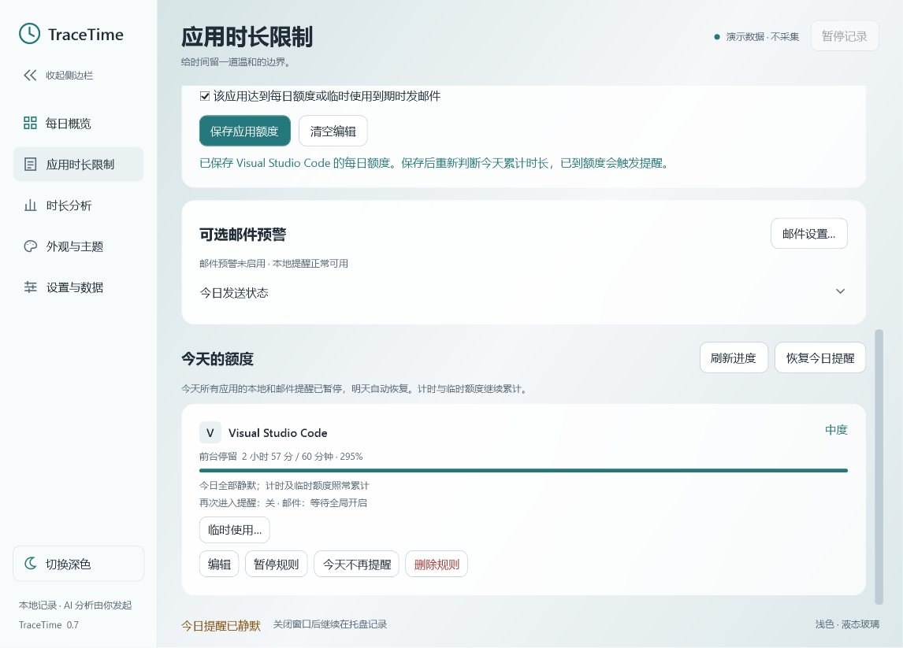

# 0.7 搜索、快捷操作与历史管理

## 更快找到应用和日期

每日概览的搜索框按应用名称查找，支持中文、忽略英文大小写，清空搜索即可恢复完整排行。搜索只筛选列表：双时长总计、原有名次、占比分母和图表仍按当天全部应用计算。选择某一行时，时间片筛选继续遵循原有规则。

「应用时长限制」也有名称搜索，同时筛选应用选择框和已有规则。没有匹配结果时不可保存，修改或清空搜索即可继续。不扫描磁盘寻找未记录应用。

日期下面的「上个有记录日」「下个有记录日」跳过空白日期；「最近有记录日」回到最近一次有前台记录的日期。空闲期间的前台停留也算有记录，暂停空档不算。原有日历仍允许选择无记录日期。

## 常用分钟和今日静默

开启临时使用时，可勾选「设为常用时长，下次默认使用」。范围仍是1–120分钟，首次为10分钟。偏好独立保存，重启后恢复；以后新打开的提醒窗口也使用这个分钟数。取消弹窗不会改变偏好。

额度列表标题旁的「今日全部静默」暂缓所有应用的本地与邮件提醒，包括被搜索隐藏的规则和今天新建的规则。计时及临时额度仍按原规则累计，次日自动恢复。

点击「恢复今日提醒」结束全局静默，不改每条规则的启停、每日额度，也不会撤销单独选择过的「今天不再提醒」。恢复后重新按规则判断，已经取消的邮件不会自动补发。已经交给邮箱服务商的邮件无法撤回。

## 历史备份

在「设置与数据 → 历史备份与归档」查看数据库、写入日志体积和应用时间片数量，点击「备份全部历史…」选择保存位置。

归档为单个 `.ttarchive` 文件，只包含应用身份、名称、可执行文件路径、前台/空闲/中断区间与归档日期范围。它不包含规则、外观、临时分钟偏好、AI/邮件账号或密钥。文件未加密，请保存在你信任的位置。

备份读取运行中数据库的一致性快照，包含已提交到WAL日志的记录，原记录继续保留。不能把单独复制正在使用的 `usage.db` 当作等价操作。默认保存目录为用户数据目录下的 `backups`；需要防范同一磁盘损坏时，可在保存对话框选择其他磁盘并保留副本。

## 按月归档与保留

在日期框中选择目标月份里的任意一天，再点击「归档这个月…」。跨月时间片在月边界裁剪，双时长与中断区间按原有口径保存。

默认仅创建文件，**不删除原记录**。如果主动勾选「归档成功后，询问是否从应用中移除该月记录」，程序会先完成并检查归档，再单独询问是否移除。仅已经结束的月份允许移除；当前月可归档并保留。取消移除确认时，归档和原记录都保留。

从应用中移除记录会产生可复用的SQLite空间，数据库文件不一定立即缩小。此版本没有自动清理、自动保留期限或后台定时归档。

## 恢复历史

1. 点击「恢复历史归档…」，选择 `.ttarchive` 文件。
2. 程序检查文件格式、完整性和日期范围，显示原时区中的起止时间及三类区间数量；无法识别原时区时明确使用UTC。
3. 确认后，先在 `backups` 创建 `before-restore-…ttarchive` 安全备份；安全备份失败不会开始替换。
4. 暂缓采集，按归档的精确时间范围替换当前历史。范围之外的历史保留，重复恢复不会叠加时长；区间内晚于备份的新记录会被替换，但仍可从恢复前备份找回。
5. 成功后恢复之前的采集/暂停状态并刷新界面。为避免恢复的旧记录立即触发提醒，当天所有提醒先静默，可手动恢复；原规则、外观和账号配置保留。

预览后文件内容改变时会拒绝恢复，恢复事务中途失败会回滚。误选归档后，可以再选择对应的 `before-restore-…ttarchive` 恢复原历史；该操作也会先生成新的安全备份。

如果历史已成功恢复，但临时副本因文件占用未能删除，界面会同时显示恢复成功和临时副本位置；这不表示恢复失败，可稍后清理该临时副本。

仅支持本应用创建的版本1归档，单文件上限2GiB、每类区间最多500万条。普通SQLite文件、依赖外部WAL的文件和损坏归档会被拒绝。这些上限是输入保护，不代表已完成如此规模的性能实测。

## 本轮验证

开发与发布检查使用隔离演示数据，覆盖搜索与总计、记录日期跳转、静默与原状态隔离、偏好重启、月边界/夏令时、WAL归档、重复恢复、恢复前备份、空库撤回、哈希变化拒绝及失败回滚。没有在用户真实数据库上执行归档后移除或恢复；完整结果见 [验证记录](VALIDATION.md)。
