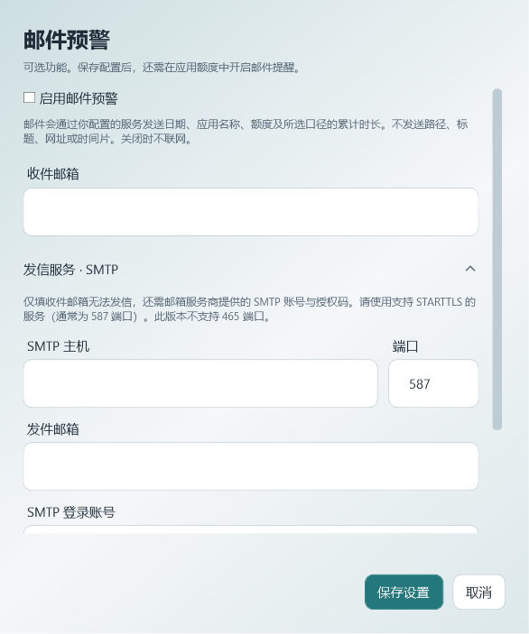

# 0.6 提醒、临时使用与邮件

## 每次进入超时应用

在「应用时长限制」保存每日额度与提醒强度，可勾选「再次进入超时应用时提醒」。同一次前台停留只呈现一次，切到其他应用后再回来才会重新提醒。TraceTime 自身窗口不会制造一次新访问。

轻度使用托盘通知及已配置音效；中度显示不主动激活的置顶窗口；严重请求唤起 TraceTime 并置顶。Windows 可能限制通知、声音和前台焦点。提醒不关闭或封锁应用。

「知道了」结束本次提醒；「今天不再提醒」暂停该应用当天本地和邮件提醒。「暂停规则」则停用规则。旧版已保存的今天忽略状态继续保留；重新保存规则会重置当天状态。关闭再次进入选项后，每日额度只提醒一次；临时使用到期仍会独立提醒。

## 提前开启临时使用

每条已启用的规则都有「临时使用…」：选择 5／10／15／30 分钟，或输入 1–120 分钟。可以先开启，再打开目标应用。提醒弹窗首次可直接开启10分钟；0.7起会使用已保存的常用分钟偏好。

- 按目标应用的**前台停留**累计消耗，包含没有键鼠输入的时间。每日额度仍使用规则原先选择的口径。
- 切到后台、暂停采集、锁屏或休眠不会消耗；TraceTime 未运行的时段不会补算。
- 临时额度跨进程重启保存，到本地次日结束。可以调整或取消；调整从当前累计值重新给定分钟数。
- 到期后按原强度提醒，即使当日总额度还未达到。取消后恢复每日额度规则。若今天已忽略，主动开启临时使用会重新启用当天提醒。

## 可选邮件

邮件默认关闭，需要同时满足「邮件设置」中全局启用和规则中开启邮件。仅填收件邮箱不能发信，还需要你自己的 SMTP 发信服务、发件邮箱、登录账号和授权码／应用密码。

当前支持强制 STARTTLS，常用端口为 **587**；不支持 465 隐式 TLS。服务没有 STARTTLS 会失败，不降级为明文认证。密码由当前 Windows 用户 DPAPI 加密存于数据目录 `email-settings.json`，更换发信主机、端口、账号或发件邮箱需重新输入凭据。保存配置不发测试邮件；启用后已经到达额度的规则也会参与下一次检查。

邮件包含日期、应用名称、所选口径的累计时长，以及每日达到／临时到期的事件类型；每日达到事件另含每日额度。SMTP 服务及收件邮箱会收到这些内容；不发送可执行文件路径、窗口标题、网址、文档名、键盘内容、截图或原始时间片。

每日达到额度和每次临时到期分别去重，再次进入应用不会重复发邮件。临时使用期间达到每日额度仍可收到每日邮件，临时使用仅暂缓本地弹窗。重新保存／暂停规则会修订规则并重新判断时长。

后台采用单队列异步发送，有约 20 秒网络超时。失败只留状态，不自动重试；在「今日发送状态」检查后可手动重试。中止或超时可能已投递，重试前检查收件箱。显示“发信服务已接收”不保证到达收件箱。跨日不补发旧提醒；发信队列检查时清理超过7天的状态，界面展示当天最近12条。关闭配置或规则会取消尚未发出的邮件；已经交给服务商的邮件无法撤回。

邮件关闭时不启动 SMTP 网络请求。暂停记录时不启动下一封发送；正在进行的发送可能完成。不需要 AI 配置、云账号或手机端。删除日期范围的使用记录时，同步删除对应日期的邮件摘要和临时状态；规则设置保留，邮件服务商已收到的副本不受影响。

## 保持轻量的后续优先级

其中1、2、3已在0.7实现：应用/规则名称搜索、有记录日期跳转、常用临时分钟、今日全部静默、历史备份/按月归档/恢复。实际操作见 [搜索、快捷操作与历史管理](HISTORY-AND-QUICK-ACTIONS.md)。第4项仍是后续测量计划。

1. **应用搜索与最近有记录日期跳转**：减少长列表翻找，复用现有 SQLite 和图标缓存，收益大、维护成本低。
2. **规则快捷操作**：常用临时分钟数偏好、批量暂停今日提醒；避免再增加常驻面板和复杂策略编辑器。
3. **历史数据保留与备份**：可选按月归档、明确恢复入口；先测真实数据库体积，避免默认删除用户记录。
4. **资源优化以测量为依据**：优先检查后台重复整日查询、缓存失效和图标队列；分别记录空闲托盘与打开图表的 CPU／内存。当前不宣称已有长期性能基准。

暂不建议加入账号系统、自动 AI 分析、实时云同步或重写 Windows UI。这些会引入联网、维护及常驻资源成本。

## Flutter 手机端可行性（待定，未开发）

Flutter 适合共享界面和报表，但无法直接复用 WPF 界面、C# 采集层，也不能绕过系统权限。可复用的是双口径定义、数据交换格式、提醒规则和场景规格；计时内核移植需要重新验证。

| 方向 | 可行性与限制 | 建议 |
| --- | --- | --- |
| 手机只查看电脑报告 | 可以用 Flutter 展示导入的每日应用汇总；后续可评估用户主动的局域网传输 | 成本最低，适合作为首个原型，不必先建云账号 |
| Android 记录手机使用 | 通过 Kotlin／Java 平台通道调用 UsageStatsManager；用户需在系统设置授予使用情况访问权限。后台与厂商省电策略影响及时性 | 先做小型权限和数据准确性验证，再做完整 UI；不要承诺和 Windows 一样即时 |
| iPhone 记录与提醒 | 需 Swift 及 Family Controls／Device Activity 等 Screen Time 原生能力。授权、扩展及隐私模型与 Windows 不同；分发须申请相应 entitlement，Apple 审核 | 先验证权限与分发资格，再决定支持的功能，不承诺完整复制 Windows 应用排行或全局采集 |

手机上的无触摸时间不能等同 Windows 键鼠空闲，应单独定义或省略“扣除空闲后”，不要将系统屏幕时长直接标成同一口径。优先做只读报告原型，再评估 Android 本机采集，iOS 单独立项。

资料核对于 2026-11-01：

- [Microsoft：SmtpClient.EnableSsl 与 STARTTLS](https://learn.microsoft.com/en-us/dotnet/api/system.net.mail.smtpclient.enablessl?view=net-10.0)
- [Flutter：平台通道](https://docs.flutter.dev/platform-integration/platform-channels)
- [Android：UsageStatsManager 权限及查询](https://developer.android.com/reference/android/app/usage/UsageStatsManager)
- [Apple：Family Controls](https://developer.apple.com/documentation/familycontrols)
- [Apple：申请 Family Controls 分发权限](https://developer.apple.com/documentation/familycontrols/requesting-the-family-controls-entitlement)
