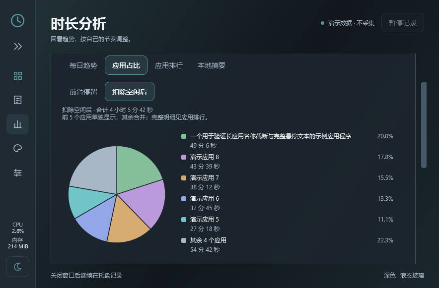

# TraceTime 0.7.1

本地更新版本，未单独创建Release；这些改进一并包含在 [0.8.0](v0.8.0.md) 中。

## 界面与图表

- 修正侧边栏按钮点击后持续显示边框的问题，保留键盘导航专用焦点提示。
- 时长分析新增「应用占比」饼图，支持近7/30日与前台停留/扣除空闲后两种口径；应用超过6个时显示前5个与其余汇总，完整排行仍可查看。
- 每日趋势柱图、概览分时柱图、状态时间轴、时长占比环图及新饼图提供精确到秒的悬停提示，显示所选范围、口径和占比含义；离开、切换页面或滚动时关闭提示。
- 明暗切换按钮上方新增TraceTime自身进程CPU/内存占用，每2秒更新；CPU按全机逻辑处理器容量归一化，内存为驻留工作集。窗口隐藏或最小化时停止采样，重新打开时重建CPU基线。

## 运行与升级

Windows x64，依赖Microsoft .NET 10 Desktop Runtime x64。先从旧版托盘选择退出，再运行新目录的 `TraceTime.exe`，保留整个文件夹。历史数据继续使用当前用户的 `%LOCALAPPDATA%\TraceTime`。

本次不更改原始计时口径，不增加外部图表库、系统性能服务或网络请求。CPU/内存数据仅用于界面显示，不写入使用记录。完整验证范围见包内 `docs/VALIDATION.md`。

构建0警告/错误，84/84场景和正式包完整流程通过；已在独立演示窗口检查鼠标提示和键盘焦点。

截图中的CPU/内存为界面验证时的即时数值，不代表日常空闲性能基准。
